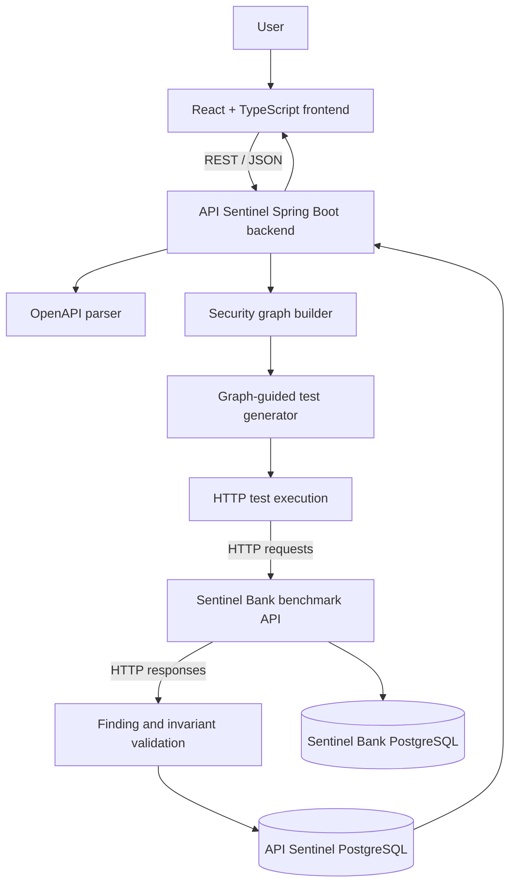

# API Sentinel

**A graph-guided, multi-identity framework for automated detection of authorization and business logic vulnerabilities in REST APIs.**

API Sentinel is a research-oriented REST API security testing platform. It models relationships between identities, roles, resources, endpoints, and business workflows to generate security test cases, execute HTTP requests against an explicitly authorized target, and validate observed responses and state changes against expected security properties.

The project combines a Spring Boot analysis backend, a React + TypeScript interface, and **Sentinel Bank**, an independent synthetic banking API used as a controlled benchmark target.

> **Research principle:** vulnerability decisions are based on explicit security models, deterministic test generation, observed HTTP behavior, and evidence-backed validation. An LLM is not used to decide whether a vulnerability exists.

---

## Table of contents

- [Why API Sentinel?](#why-api-sentinel)
- [What it currently does](#what-it-currently-does)
- [How it works](#how-it-works)
- [Architecture](#architecture)
- [Technology stack](#technology-stack)
- [Repository structure](#repository-structure)
- [Demonstrated benchmark scenario](#demonstrated-benchmark-scenario)
- [Getting started](#getting-started)
- [Configuration](#configuration)
- [Run the applications](#run-the-applications)
- [Tests and build](#tests-and-build)
- [API endpoints](#api-endpoints)
- [Security and responsible use](#security-and-responsible-use)
- [Project status and research limitations](#project-status-and-research-limitations)
- [Documentation](#documentation)

## Why API Sentinel?

REST API authorization flaws are often dependent on context that is not visible from an endpoint definition alone. Testing an endpoint with a single identity and a single request may miss weaknesses involving:

- A user accessing another user's resource.
- A lower-privileged identity invoking a restricted operation.
- An operation being accepted in an invalid business workflow state.
- A sequence of requests changing state in a way that violates an expected invariant.

API Sentinel explores a model-driven approach to these problems. It represents relevant security relationships and uses them to derive test scenarios across multiple identities and resources.

## What it currently does

The current implementation includes:

- **OpenAPI ingestion:** upload an OpenAPI document and parse its paths, operations, tags, parameters, and request-body requirements.
- **Security graph construction:** represent benchmark identities, roles, resources, endpoints, and relationships in a graph.
- **Graph-guided test generation:** generate cross-identity BOLA and role-based BFLA test cases from graph relationships.
- **HTTP test execution:** execute generated test cases against the configured target using the corresponding benchmark identity credentials.
- **Stateful workflow testing:** execute a payment scenario that creates a payment, attempts an unauthorized approval, and checks the resulting state.
- **Finding detection:** evaluate execution results against expected authorization behavior and business-state invariants.
- **Finding persistence:** store findings in the API Sentinel PostgreSQL database and retrieve them through the findings API.
- **Web interface:** inspect the overview, uploaded specifications, security graph, test runs, and persisted findings.

The project is actively being prepared for deployment and broader research evaluation. See [Project status and research limitations](#project-status-and-research-limitations) for the current scope.

## How it works

At a high level, the workflow is:

1. Upload an OpenAPI specification.
2. Parse the API operations into endpoint summaries.
3. Build the benchmark security graph using endpoint and identity/resource relationships.
4. Generate graph-guided authorization test cases.
5. Execute the test cases against the configured target API.
6. Validate the observed HTTP responses and, for stateful scenarios, the resulting workflow state.
7. Persist findings with the observed evidence for review.

The graph-guided generator currently includes BOLA and BFLA test generation. Stateful payment business-logic testing is implemented as a dedicated benchmark scenario.

## Architecture

API Sentinel is split into three applications with separate responsibilities.



**Application boundary:** API Sentinel communicates with Sentinel Bank over HTTP. The scanner and benchmark target use separate PostgreSQL databases; the scanner should not inspect the benchmark database to decide whether a vulnerability exists.

### Main components

| Component | Responsibility |
|---|---|
| `sentinel-frontend` | Dashboard and workflows for specifications, graph, test runs, and findings |
| `sentinel-backend` | OpenAPI parsing, graph construction, test generation, HTTP execution, validation, and finding persistence |
| `sentinel-bank` | Independent synthetic banking API with configurable secure/vulnerable authorization behavior |
| API Sentinel PostgreSQL | Stores persisted security findings |
| Sentinel Bank PostgreSQL | Stores synthetic benchmark users, accounts, and payments |

## Technology stack

| Layer | Technologies |
|---|---|
| Backend | Java 21, Spring Boot 4, Spring MVC |
| API specification parsing | Swagger / OpenAPI Parser |
| Graph modelling | JGraphT |
| Persistence | Spring Data JPA, PostgreSQL, Flyway |
| Target API security | Spring Security, HTTP Basic authentication for benchmark identities |
| Frontend | React 19, TypeScript, React Router |
| Frontend tooling and styling | Vite, Tailwind CSS |
| HTTP client | Axios |
| Backend testing | JUnit 5, Spring Boot Test |
| Build tools | Maven, npm |

## Repository structure

```text
api-sentinel/
├── sentinel-backend/       # Main scanner backend
│   └── src/
│       ├── main/java/      # Controllers, graph, services, test generation, findings
│       ├── main/resources/ # Application configuration and Flyway migrations
│       └── test/java/      # Backend tests
│
├── sentinel-bank/           # Independent benchmark target API
│   └── src/
│       ├── main/java/
│       └── main/resources/  # Target configuration and database migrations
│
├── sentinel-frontend/       # React + TypeScript frontend
│   └── src/
│       ├── api/
│       ├── App.tsx
│       ├── SpecificationsPage.tsx
│       ├── SecurityGraphPage.tsx
│       ├── TestRunsPage.tsx
│       └── FindingsPage.tsx
│
├── ARCHITECTURE.md
├── API_CONTRACTS.md
└── DATABASE_SCHEMA.md
```

## Demonstrated benchmark scenario

The current stateful benchmark demonstrates why response codes alone are not enough to validate business logic.

The scenario creates a payment as a customer, attempts to approve it using that same customer identity, and then reads the payment to inspect its final state.

| Check | Secure mode | Vulnerable mode |
|---|---:|---:|
| Payment creation | HTTP 201 | HTTP 201 |
| Unauthorized approval | HTTP 403 | HTTP 200 |
| Final payment state | `PENDING` | `APPROVED` |
| Expected invariant | Preserved | Violated |

In the vulnerable run, API Sentinel detected that an unauthorized approval changed the payment from `PENDING` to `APPROVED` and persisted a high-severity business-logic finding with execution evidence.

This is a demonstrated benchmark scenario, not a claim that every possible payment workflow or business-logic vulnerability is currently covered.

## Getting started

### Prerequisites

Install the following:

- Java Development Kit (JDK) 21
- Apache Maven
- Node.js and npm
- PostgreSQL 17 (or a compatible supported PostgreSQL version)

You will need two separate PostgreSQL databases:

- `api_sentinel_db` for the scanner backend
- `sentinel_bank_db` for the Sentinel Bank benchmark target

Use separate database users with only the permissions required by their respective applications. Do not reuse production credentials for local benchmark testing.

### Clone the repository

```bash
git clone https://github.com/monisha0705/api-sentinel.git
cd api-sentinel
```

### Database preparation

Create the two databases and their application users in PostgreSQL before starting the applications.

The current local configuration expects:

| Application | Database | Database user |
|---|---|---|
| API Sentinel | `api_sentinel_db` | `sentinel_app` |
| Sentinel Bank | `sentinel_bank_db` | `bank_app` |

Flyway migrations are included separately in each application's resources. The applications must be configured with the matching database password through environment variables.

> The benchmark also requires the dedicated synthetic test identities and matching credentials expected by the scanner. Provision benchmark credentials locally; never copy credentials from another environment or commit them to Git.

## Configuration

Set the following environment variables in the shell used to start each application. Values below are placeholders, not real credentials.

### API Sentinel backend

| Variable | Purpose |
|---|---|
| `API_SENTINEL_DB_PASSWORD` | Password for the `sentinel_app` database user |
| `API_SENTINEL_ALICE_PASSWORD` | Benchmark Alice identity password |
| `API_SENTINEL_BOB_PASSWORD` | Benchmark Bob identity password |
| `API_SENTINEL_ADMIN_PASSWORD` | Benchmark Admin identity password |

The backend's local defaults use port `8080` and target base URL `http://localhost:8081`.

### Sentinel Bank

| Variable | Purpose |
|---|---|
| `SENTINEL_BANK_DB_PASSWORD` | Password for the `bank_app` database user |
| `SENTINEL_BANK_AUTHORIZATION_MODE` | Target authorization mode: `SECURE` or `VULNERABLE` |

Sentinel Bank uses port `8081`. Its default authorization mode is `SECURE`.

**PowerShell example** (replace each placeholder locally):

```powershell
$env:API_SENTINEL_DB_PASSWORD = "<scanner-database-password>"
$env:API_SENTINEL_ALICE_PASSWORD = "<benchmark-alice-password>"
$env:API_SENTINEL_BOB_PASSWORD = "<benchmark-bob-password>"
$env:API_SENTINEL_ADMIN_PASSWORD = "<benchmark-admin-password>"

$env:SENTINEL_BANK_DB_PASSWORD = "<benchmark-database-password>"
$env:SENTINEL_BANK_AUTHORIZATION_MODE = "SECURE"
```

Do not paste actual passwords into source files, README examples, issue reports, screenshots, or commits.

## Run the applications

Open separate terminals from the repository root.

### 1. Start Sentinel Bank

```powershell
mvn -f .\sentinel-bank\pom.xml spring-boot:run
```

Sentinel Bank listens on `http://localhost:8081`.

### 2. Start the API Sentinel backend

```powershell
mvn -f .\sentinel-backend\pom.xml spring-boot:run
```

The backend listens on `http://localhost:8080`.

Health endpoint:

```text
GET http://localhost:8080/actuator/health
```

### 3. Start the frontend

```powershell
cd .\sentinel-frontend
npm install
npm run dev
```

The Vite development server is normally available at `http://localhost:5173`. Its development proxy forwards `/api` and `/actuator` requests to the backend at `http://localhost:8080`.

## Tests and build

Run the API Sentinel backend tests from the repository root:

```powershell
mvn -f .\sentinel-backend\pom.xml test
```

Build the frontend for production:

```powershell
cd .\sentinel-frontend
npm run build
```

The frontend build runs TypeScript project compilation followed by the Vite production build.

## API endpoints

The following application endpoints are implemented in the current backend:

| Method | Endpoint | Purpose |
|---|---|---|
| `POST` | `/api/v1/specifications/upload` | Upload and parse an OpenAPI document |
| `POST` | `/api/v1/graph/build` | Build and return the benchmark security graph |
| `POST` | `/api/v1/tests/generate` | Generate graph-guided test cases |
| `POST` | `/api/v1/tests/execute` | Execute supplied test cases |
| `POST` | `/api/v1/tests/execute/stateful` | Execute the stateful unauthorized payment approval scenario |
| `POST` | `/api/v1/findings/detect` | Detect and persist findings from test execution results |
| `POST` | `/api/v1/findings/detect/stateful` | Detect and persist a stateful business-logic finding |
| `GET` | `/api/v1/findings` | Retrieve persisted findings |

For request and response details, see [API_CONTRACTS.md](API_CONTRACTS.md). The implementation is the source of truth where older contract documentation differs.

## Security and responsible use

API Sentinel is intended for authorized security testing, controlled benchmarks, and research.

- Only test APIs that you own or have explicit permission to assess.
- Use the included Sentinel Bank benchmark for local experimentation.
- Keep scanner and target database credentials separate.
- Store secrets in environment variables or a dedicated secrets manager, never in Git.
- Use synthetic data in benchmark environments.
- Review state-changing tests and target scope before execution.
- Do not expose a vulnerable benchmark mode to the public internet.
- Treat captured request and response evidence as potentially sensitive.

## Project status and research limitations

The repository contains a working implementation of the OpenAPI upload/parsing flow, benchmark security graph construction, graph-guided BOLA/BFLA test generation, HTTP test execution, a stateful payment authorization scenario, finding detection/persistence, and the corresponding frontend views.

The following remain separate work items and must not be inferred as complete from the existence of design documentation:

- Production deployment and production smoke/security testing.
- A complete, reproducible comparison of rule-based, graph-guided, and hybrid approaches.
- Dataset/ground-truth expansion and quantitative research evaluation.
- Full coverage of the broader workflow, authorization, and business-logic scenarios described in the architecture design.
- Production hardening of target configuration, credential management, scan isolation, and operational controls.

Research metrics such as precision, recall, F1 score, false-positive rate, and coverage should be published only after controlled experiments have been executed and documented.

## Documentation

- [System architecture](ARCHITECTURE.md)
- [API contracts](API_CONTRACTS.md)
- [Database schema design](DATABASE_SCHEMA.md)

---

**Project:** API Sentinel  
**Research focus:** Graph-guided, multi-identity REST API authorization and business-logic security testing.
