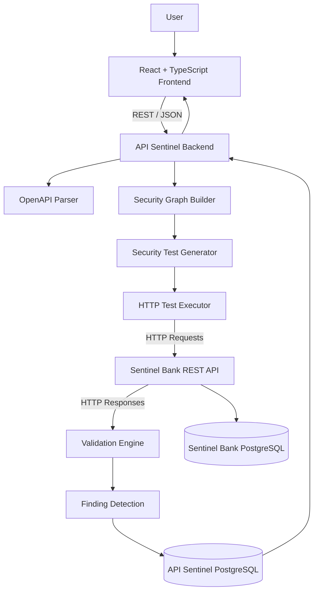

# API Sentinel

### A Graph-Guided, Multi-Identity Framework for Automated Detection of Authorization and Business Logic Vulnerabilities in REST APIs

API Sentinel is a research-oriented REST API security testing platform that investigates authorization weaknesses and business logic vulnerabilities through structured security modelling, multi-identity testing, graph-based relationships, and evidence-driven validation.

The platform processes OpenAPI specifications, constructs security representations, generates security test cases, executes HTTP requests against authorized targets, and evaluates observed responses and application state changes against expected security properties.

It consists of three independent applications:

- **API Sentinel Backend:** Java and Spring Boot security analysis engine.
- **Sentinel Bank:** Independent synthetic banking API used as a controlled benchmark.
- **API Sentinel Frontend:** React and TypeScript interface for interacting with the scanner.

> **Research principle:** Vulnerability detection is based on explicit security models, deterministic test generation, observable HTTP behavior, and evidence-backed validation. An LLM is not used to decide whether a vulnerability exists.

---

## Table of Contents

1. [Research Motivation](#1-research-motivation)
2. [Research Objectives](#2-research-objectives)
3. [Current Capabilities](#3-current-capabilities)
4. [System Workflow](#4-system-workflow)
5. [System Architecture](#5-system-architecture)
6. [Technology Stack](#6-technology-stack)
7. [Repository Structure](#7-repository-structure)
8. [Benchmark Demonstration](#8-benchmark-demonstration)
9. [Getting Started](#9-getting-started)
10. [Configuration](#10-configuration)
11. [Running the Applications](#11-running-the-applications)
12. [Testing and Build](#12-testing-and-build)
13. [API Endpoints](#13-api-endpoints)
14. [Database Architecture](#14-database-architecture)
15. [Security and Responsible Use](#15-security-and-responsible-use)
16. [Research Evaluation](#16-research-evaluation)
17. [Implementation Status and Limitations](#17-implementation-status-and-limitations)
18. [Documentation](#18-documentation)

---

## 1. Research Motivation

REST API authorization vulnerabilities frequently depend on relationships that cannot be understood by examining an endpoint in isolation.

A single API request may not reveal whether:

- A customer can access another customer's resource.
- A lower-privileged identity can invoke a restricted operation.
- An operation can be performed in an invalid business workflow state.
- A sequence of requests can cause an unauthorized application state transition.

Traditional endpoint-oriented testing may fail to capture these relationships, particularly when multiple identities and dependent operations are involved.

API Sentinel investigates a model-driven approach that represents security-relevant relationships between identities, roles, resources, endpoints, and workflow states.

The research explores how these relationships can support more systematic authorization and business logic security testing.

### Vulnerability categories

| Category | Description |
|---|---|
| BOLA | Broken Object Level Authorization: unauthorized access to another identity's resources |
| BFLA | Broken Function Level Authorization: unauthorized access to restricted API operations |
| Business Logic | Violations of expected business workflows, authorization requirements, or valid state transitions |

## 2. Research Objectives

The project aims to:

1. Parse REST API specifications using OpenAPI.
2. Extract and normalize API endpoints and operations.
3. Represent security-relevant entities and relationships.
4. Model identities, roles, resources, and ownership relationships.
5. Construct a typed security graph.
6. Generate security test cases using structured rules and graph relationships.
7. Execute generated tests against authorized REST API targets.
8. Validate authorization behavior and observable workflow state changes.
9. Detect BOLA, BFLA, and business logic vulnerabilities.
10. Persist findings and supporting execution evidence.
11. Develop a controlled benchmark for reproducible experiments.
12. Evaluate different test generation strategies using measurable research metrics.

The central research question is whether graph-guided, multi-identity testing can improve automated detection of authorization and business logic vulnerabilities compared with simpler testing approaches.

## 3. Current Capabilities

The current implementation provides the following capabilities.

### OpenAPI processing

- Upload an OpenAPI specification.
- Parse API paths and operations.
- Extract relevant endpoint information.
- Process parameters and request-body requirements.

### Security graph construction

- Represent benchmark identities and roles.
- Represent resources and API endpoints.
- Construct security-related relationships.
- Provide a graph representation for security testing.

The current graph is benchmark-specific: it uses the synthetic Alice, Bob, and Admin identities, fixed benchmark account ownership, and endpoint-path heuristics. It does not yet infer arbitrary authorization policies from an uploaded OpenAPI document.

### Security test generation

- Generate BOLA test cases.
- Generate BFLA test cases.
- Use benchmark identities and security relationships to construct test scenarios.

### HTTP execution

- Execute generated test cases against the configured target.
- Use the corresponding benchmark identity credentials.
- Capture observed HTTP behavior.

### Stateful workflow testing

- Create a payment.
- Attempt unauthorized payment approval.
- Retrieve the payment.
- Evaluate its resulting state.

### Finding detection and persistence

- Evaluate execution results against expected security behavior.
- Detect authorization and business logic findings.
- Persist findings in PostgreSQL.
- Retrieve persisted findings through the findings API.

### Frontend

The React frontend provides views for:

- Overview dashboard.
- Uploaded specifications.
- Security graph.
- Test runs.
- Persisted findings.

The implementation scope and remaining research work are described in [Implementation Status and Limitations](#17-implementation-status-and-limitations).

## 4. System Workflow

The main security testing workflow is:

```text
       OpenAPI Specification
                |
                v
        Specification Upload
                |
                v
         OpenAPI Parsing
                |
                v
      Endpoint Representation
                |
                v
      Security Graph Building
                |
                v
       Security Test Generation
                |
                v
          HTTP Execution
                |
                v
        Target REST API
                |
                v
       Response / State Analysis
                |
                v
        Finding Detection
                |
                v
       Finding Persistence
                |
                v
        Results in Frontend
```

The graph-guided generator currently supports BOLA and BFLA test generation. Stateful payment business logic testing is implemented as a dedicated benchmark scenario.

## 5. System Architecture

API Sentinel consists of three independent applications.

### 5.1 API Sentinel Backend

The main security scanner is developed using Java and Spring Boot.

Responsibilities include:

- OpenAPI specification processing.
- Security graph construction.
- Security test generation.
- HTTP request execution.
- Stateful test execution.
- Response and state validation.
- Finding detection.
- Finding persistence and retrieval.

### 5.2 Sentinel Bank

Sentinel Bank is an independent Spring Boot REST API developed as a controlled benchmark target.

It simulates selected banking operations using synthetic identities, accounts, and payments.

Its purpose is to provide reproducible scenarios for evaluating authorization enforcement and business logic behavior.

The scanner communicates with Sentinel Bank through HTTP requests. It does not directly inspect the benchmark database to determine whether a vulnerability exists.

### 5.3 React Frontend

The frontend uses React and TypeScript.

It provides the interface for uploading specifications, interacting with security testing workflows, and inspecting results.

Security test generation and validation remain backend responsibilities.

### Architecture diagram



### Application boundaries

- Frontend communicates with the scanner backend.
- Scanner backend communicates with Sentinel Bank over HTTP.
- API Sentinel maintains its own database.
- Sentinel Bank maintains a separate database.
- The scanner does not directly access the benchmark database.

## 6. Technology Stack

| Layer | Technologies |
|---|---|
| Backend language | Java 21 |
| Backend framework | Spring Boot 4 |
| API specification | OpenAPI |
| API parsing | Swagger Parser |
| Graph modelling | JGraphT |
| Persistence | Spring Data JPA |
| Database | PostgreSQL 17 |
| Database migrations | Flyway |
| Target API security | Spring Security |
| Frontend | React 19, TypeScript |
| Frontend tooling | Vite |
| Graph visualization | `@xyflow/react` |
| Styling | Tailwind CSS |
| Icons | Lucide React |
| HTTP client | Axios |
| Backend testing | JUnit 5, Spring Boot Test |
| Build tools | Maven, npm |

## 7. Repository Structure

```text
api-sentinel/
│
├── sentinel-backend/
│   └── src/
│       ├── main/
│       │   ├── java/
│       │   │   └── Controllers, graph, services,
│       │   │       test generation and findings
│       │   └── resources/
│       │       └── Configuration and Flyway migrations
│       └── test/
│           └── java/
│
├── sentinel-bank/
│   └── src/
│       ├── main/
│       │   ├── java/
│       │   └── resources/
│       │       └── Target configuration and migrations
│       └── test/
│
├── sentinel-frontend/
│   └── src/
│       ├── api/
│       ├── App.tsx
│       ├── SpecificationsPage.tsx
│       ├── SecurityGraphPage.tsx
│       ├── TestRunsPage.tsx
│       └── FindingsPage.tsx
│
├── ARCHITECTURE.md
├── API_CONTRACTS.md
├── DATABASE_SCHEMA.md
└── README.md
```

## 8. Benchmark Demonstration

Sentinel Bank provides a controlled payment workflow used to demonstrate stateful authorization testing.

The scenario creates a payment using a customer identity, attempts to approve the payment using that same customer identity, and then retrieves the payment to inspect its resulting state.

### Secure versus vulnerable behavior

| Check | Secure mode | Vulnerable mode |
|---|---:|---:|
| Payment creation | HTTP 201 | HTTP 201 |
| Unauthorized approval | HTTP 403 | HTTP 200 |
| Final payment state | `PENDING` | `APPROVED` |
| Expected invariant | Preserved | Violated |

### Interpretation

In secure mode:

- The customer creates a payment.
- The customer attempts an unauthorized approval.
- The API rejects the approval.
- The payment remains `PENDING`.

In vulnerable mode:

- The customer creates a payment.
- The customer attempts the same unauthorized approval.
- The API accepts the operation.
- The payment changes to `APPROVED`.

API Sentinel detects the unauthorized state transition and persists a high-severity business logic finding with supporting execution evidence.

This is a demonstrated benchmark scenario, not a claim that every possible payment workflow or business logic vulnerability is covered.

## 9. Getting Started

### Prerequisites

Install:

- Java Development Kit (JDK) 21.
- Apache Maven.
- Node.js and npm.
- PostgreSQL 17 or a compatible supported version.

### Clone the repository

```bash
git clone https://github.com/monisha0705/api-sentinel.git

cd api-sentinel
```

### Database preparation

Create the two application databases and a separate scanner test database:

| Purpose | Database | Database user |
|---|---|---|
| API Sentinel application | `api_sentinel_db` | `sentinel_app` |
| Sentinel Bank benchmark | `sentinel_bank_db` | `bank_app` |
| API Sentinel integration tests (test-only) | `api_sentinel_test_db` | `sentinel_app` |

The test database is used by the backend integration-test profile and must be created before running the backend test suite. Do not point integration tests at a database containing data you need to preserve.

Use separate database users with only the permissions required by their respective applications.

Flyway migrations are included separately in both applications.

The benchmark also requires synthetic test identities and matching credentials expected by the scanner.

Provision benchmark credentials locally. Never commit credentials to Git.

## 10. Configuration

Set environment variables in the shell used to start each application.

The following values are placeholders.

### API Sentinel Backend

| Variable | Purpose |
|---|---|
| `API_SENTINEL_DB_PASSWORD` | Password for the `sentinel_app` database user |
| `API_SENTINEL_ALICE_PASSWORD` | Benchmark Alice identity password |
| `API_SENTINEL_BOB_PASSWORD` | Benchmark Bob identity password |
| `API_SENTINEL_ADMIN_PASSWORD` | Benchmark Admin identity password |

Default backend port: `8080`.

Default target base URL: `http://127.0.0.1:8081`.

Both Spring Boot services bind to `127.0.0.1` by default for local development. The scanner limits OpenAPI uploads to 5 MB and applies HTTP connection/request timeouts. Do not expose either service publicly without adding suitable authentication, authorization, and deployment controls.

### Sentinel Bank

| Variable | Purpose |
|---|---|
| `SENTINEL_BANK_DB_PASSWORD` | Password for the `bank_app` database user |
| `SENTINEL_BANK_AUTHORIZATION_MODE` | `SECURE` or `VULNERABLE` |

Default benchmark port: `8081`.

Default authorization mode: `SECURE`.

### PowerShell configuration example

Replace each placeholder with your own local value.

```powershell
$env:API_SENTINEL_DB_PASSWORD = "<scanner-database-password>"
$env:API_SENTINEL_ALICE_PASSWORD = "<benchmark-alice-password>"
$env:API_SENTINEL_BOB_PASSWORD = "<benchmark-bob-password>"
$env:API_SENTINEL_ADMIN_PASSWORD = "<benchmark-admin-password>"

$env:SENTINEL_BANK_DB_PASSWORD = "<benchmark-database-password>"
$env:SENTINEL_BANK_AUTHORIZATION_MODE = "SECURE"
```

Never place real passwords in source files, README examples, screenshots, issue reports, or commits.

## 11. Running the Applications

Run the applications in separate terminals from the repository root.

### 1. Start Sentinel Bank

```powershell
mvn -f .\sentinel-bank\pom.xml spring-boot:run
```

Sentinel Bank:

```text
http://127.0.0.1:8081
```

### 2. Start API Sentinel Backend

```powershell
mvn -f .\sentinel-backend\pom.xml spring-boot:run
```

Backend:

```text
http://127.0.0.1:8080
```

Health endpoint:

```http
GET http://127.0.0.1:8080/actuator/health
```

### 3. Start the Frontend

Open another terminal:

```powershell
cd .\sentinel-frontend

npm install

npm run dev
```

Frontend:

```text
http://localhost:5173
```

The Vite development proxy forwards `/api` and `/actuator` requests to the backend at `http://127.0.0.1:8080`.

### Local development ports

| Component | Port |
|---|---:|
| React frontend | 5173 |
| API Sentinel backend | 8080 |
| Sentinel Bank backend | 8081 |
| PostgreSQL | 5432 |

## 12. Testing and Build

### Run backend tests

From the repository root:

```powershell
mvn -f .\sentinel-backend\pom.xml test
```

### Build the frontend

```powershell
cd .\sentinel-frontend

npm run build
```

The frontend build runs TypeScript project compilation followed by the Vite production build.

### Run Sentinel Bank tests

```powershell
mvn -f .\sentinel-bank\pom.xml test
```

The Sentinel Bank test context uses the configured benchmark database. Keep the scanner integration-test database separate from the application database.

Record actual test and build results when documenting a release or research milestone.

## 13. API Endpoints

The following scanner endpoints are implemented in the current backend.

| Method | Endpoint | Purpose |
|---|---|---|
| POST | `/api/v1/specifications/upload` | Upload and parse an OpenAPI document |
| POST | `/api/v1/graph/build` | Build and return the benchmark security graph |
| POST | `/api/v1/tests/generate` | Generate security test cases |
| POST | `/api/v1/tests/execute` | Execute supplied test cases |
| POST | `/api/v1/tests/execute/stateful` | Execute the stateful payment approval scenario |
| POST | `/api/v1/findings/detect` | Detect and persist findings from execution results |
| POST | `/api/v1/findings/detect/stateful` | Detect and persist a stateful business logic finding |
| GET | `/api/v1/findings` | Retrieve persisted findings |

For request and response structures, see [API_CONTRACTS.md](API_CONTRACTS.md).

The implemented backend is the source of truth where older documentation differs.

## 14. Database Architecture

API Sentinel and Sentinel Bank maintain separate PostgreSQL databases.

### API Sentinel database

Database: `api_sentinel_db`

The current implementation includes the `security_findings` table and indexes for finding-related fields.

It stores detected security findings.

### Sentinel Bank database

Database: `sentinel_bank_db`

Implemented migrations create:

- `bank_users`
- `accounts`
- `payments`
- `payment_events`

The database stores synthetic benchmark identities, accounts, and payment workflow data.

### Database isolation

The scanner stores security testing results and findings.

Sentinel Bank stores benchmark application data.

Communication between the applications occurs through HTTP rather than direct database access.

For further schema details, see [DATABASE_SCHEMA.md](DATABASE_SCHEMA.md).

## 15. Security and Responsible Use

API Sentinel is intended for authorized security testing, controlled benchmarks, and academic research.

- Only test APIs that you own or have explicit permission to assess.
- Use Sentinel Bank for local experimentation.
- Keep scanner and target database credentials separate.
- Store secrets in environment variables or a secrets manager.
- Never commit passwords or authentication tokens.
- Use synthetic benchmark data.
- Review state-changing tests and target scope before execution.
- Do not expose vulnerable benchmark configurations to the public internet.
- Treat captured request and response evidence as potentially sensitive.

## 16. Research Evaluation

The proposed research evaluation compares three test generation strategies:

1. `RULE_BASED`
2. `GRAPH_GUIDED`
3. `HYBRID`

The comparison should use equivalent benchmark scenarios, test identities, request budgets, and execution constraints.

### Evaluation metrics

| Metric | Purpose |
|---|---|
| True Positives | Vulnerable scenarios correctly detected |
| False Positives | Secure scenarios incorrectly reported |
| False Negatives | Vulnerable scenarios missed |
| Precision | Proportion of reported findings that are correct |
| Recall | Proportion of vulnerable scenarios detected |
| F1 Score | Harmonic mean of precision and recall |
| False Positive Rate | Proportion of secure scenarios incorrectly flagged |
| Endpoint Coverage | Proportion of relevant endpoints tested |
| Execution Time | Time required to complete testing |

Formulas:

**Precision**

`TP / (TP + FP)`

**Recall**

`TP / (TP + FN)`

**F1 Score**

`2 × Precision × Recall / (Precision + Recall)`

**False Positive Rate**

`FP / (FP + TN)`

The classification unit should be a unique ground-truth vulnerability scenario, not an individual HTTP request.

Metrics and comparative claims should be published only after controlled experiments have been executed and documented.

## 17. Implementation Status and Limitations

The project currently has a working security testing foundation.

| Component | Status |
|---|---|
| Spring Boot scanner foundation | Implemented |
| OpenAPI upload and parsing | Implemented |
| Security graph construction | Implemented |
| BOLA/BFLA test generation | Implemented |
| HTTP request execution | Implemented |
| Stateful payment test execution | Implemented |
| Response and state validation | Implemented |
| Finding detection | Implemented |
| Finding persistence and retrieval | Implemented |
| Sentinel Bank payment workflow | Implemented |
| React frontend foundation | Implemented |
| Expanded workflow and policy modelling | Planned extension |
| Advanced graph exploration and prioritization | Planned extension |
| Complete comparison of RULE_BASED, GRAPH_GUIDED, and HYBRID | Planned research extension |
| Research experiment orchestration | Planned extension |
| Automated research reporting | Planned extension |
| Production deployment and hardening | Planned extension |

### Research limitations

The current benchmark does not represent every possible REST API architecture or vulnerability scenario.

Further work is required in:

- Benchmark scenario expansion.
- General-purpose identity and authorization modelling.
- Broader business workflow coverage.
- Advanced graph exploration.
- Reproducible comparative experiments.
- Production security hardening.
- Quantitative evaluation and reporting.

Implementation status must be updated as features are completed and verified.

## 18. Documentation

| Document | Description |
|---|---|
| [ARCHITECTURE.md](ARCHITECTURE.md) | System architecture, modules, application boundaries, and roadmap |
| [API_CONTRACTS.md](API_CONTRACTS.md) | Scanner API endpoints and request/response contracts |
| [DATABASE_SCHEMA.md](DATABASE_SCHEMA.md) | Implemented database migrations and proposed schema design |

---

**Project:** API Sentinel

**Research Focus:** Graph-guided, multi-identity REST API authorization and business logic security testing.

**Development Principle:** Every implemented feature and research claim must be supported by verifiable code, tests, or experimental evidence.
